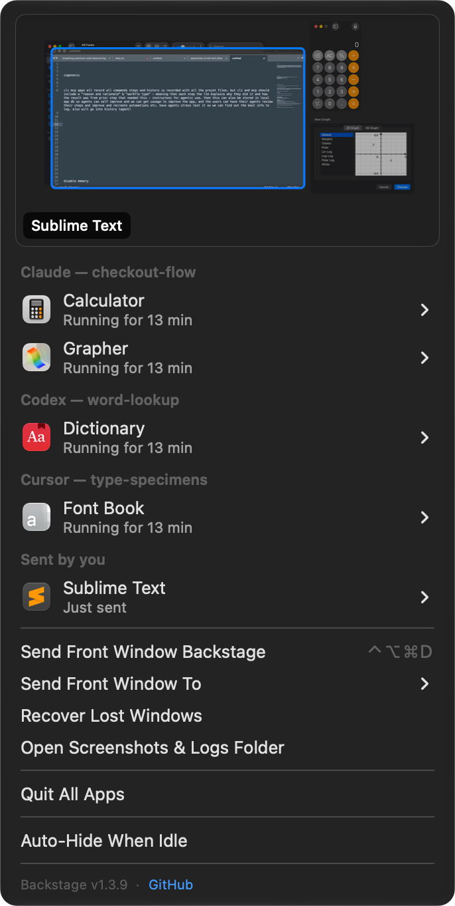

# backstage

**A hidden display for your Mac. Coding agents run, test and click through apps there without
taking over your screen, and you can send your own apps there to keep them running out of the
way.**

backstage adds an invisible virtual display that only it can see, and keeps it out of reach of
your cursor, your keyboard focus and your speakers. Two kinds of apps live there:

- **Apps an agent launches.** When an agent builds a Mac app and wants to check it works, the
  window normally pops up in front of you, steals focus and fights you for the mouse. With
  backstage the app opens on the hidden display instead. The agent still sees it (screenshots,
  the accessibility tree) and uses it (clicks, typing, menus, drags) while you keep working, and
  hands it to you when you ask to see it.
- **Apps you send there.** Press **⌃⌥⌘B** and the app in front of you moves backstage: still
  running, out of sight, muted, and out of your way when you type. Bring it back from the menu
  bar whenever you like. While it's there, an agent can work in it for you, with your documents
  and logged-in state intact.

```bash
backstage launch build/MyApp.app      # an agent: hidden; nothing appears on your screen
backstage screenshot                  # it looks at the app
backstage find --role button --text Export
backstage press w8432.0.3             # and uses it
backstage show                        # you asked to see it: handed over, state intact
```

It ships with an [agent skill](dist/skills/backstage/SKILL.md) and an optional hook for
**Claude Code, Codex, Grok, Cursor and OpenCode**, which teach agents to keep their own testing
hidden and to put things on your screen only when you ask.

<p align="center">
  
  <br>
  <sub>The <a href="#menu-bar">menu bar menu</a> while three agents test apps out of sight, next to an app you sent backstage.</sub>
</p>

## Contents

[Requirements](#requirements) · [Install](#install) · [Quick start](#quick-start) ·
[Menu bar](#menu-bar) · [Sending your own apps backstage](#sending-your-own-apps-backstage) ·
[Agents](#agents) · [How it works](#how-it-works) · [Sound](#sound) ·
[Cheat sheet](#cheat-sheet) · [Limits](#limits) · [Development](#development) ·
[Command reference](docs/USAGE.md) · [Changelog](CHANGELOG.md)

## Requirements

- **macOS 14.2 or later** (tested on macOS 27.0.1, Apple Silicon). Every app backstage runs is
  muted, which needs 14.2's audio taps; on 14.0 and 14.1, `launch` refuses.
- **Permissions** for whatever runs backstage (your terminal or agent host), in System Settings ›
  Privacy & Security: **Accessibility** and **Screen & System Audio Recording**. For agents to
  check what an app plays (`launch --audio`), the host also needs **System Audio Recording
  Only**, a separate switch in the same pane; muting works without it.
  - The audio grant belongs to the app that started the backstage daemon (the terminal or agent
    host that ran the first `backstage` command), not to `backstage` itself, and it's keyed to
    that host's binary path, so updating the host may need it granted again. `backstage doctor`
    names the host (`audio.host`).
  - `backstage doctor` checks everything. Its audio self-test is what makes macOS ask for System
    Audio Recording the first time.
- Building from source needs Xcode or the Command Line Tools (Swift 5.9 or later).

## Install

With [Homebrew](https://brew.sh):

```bash
brew tap andrewfitz/tap
brew install backstage
backstage doctor              # check permissions
backstage start               # the menu bar icon and ⌃⌥⌘B
backstage install --hooks     # optional: skill + hook for your coding agents
```

Bottles cover macOS 15 and later on Apple Silicon; other Macs build from source (needs Xcode).
If you installed from the old `andrewfitz/backstage` tap, `brew update` moves backstage to
`andrewfitz/tap`.

After `brew upgrade backstage`, run `backstage stop --all && backstage start` so the daemon runs
the new version. This quits the apps backstage runs (yours are given back if they don't quit),
and your monitor doesn't blink: the hidden display is kept for the new daemon.

From source:

```bash
git clone https://github.com/andrewfitz/backstage.git
cd backstage
make install    # $(PREFIX)/bin/backstage and $(PREFIX)/lib/backstage/libbackstage-inaudible.dylib
                # (PREFIX=/opt/homebrew by default; `make install PREFIX=/usr/local` elsewhere)
```

`make uninstall` stops the daemon and removes both. Use Homebrew or `make install`, not both: a
`make install` copy in `/opt/homebrew/bin` stops Homebrew from linking its own.

## Quick start

**Send one of your own apps backstage:** run `backstage start` once, then press **⌃⌥⌘B** in any
app. Its windows leave your screen and the menu bar icon counts one more app. To get it back,
open the menu, pick the app, and choose **Show on My Screen**.

**Let an agent test an app hidden:** run `backstage install` (add `--hooks` for the hook), then
ask your agent to build and check your app as usual. It uses commands like these:

```bash
backstage launch Calculator           # a .app path, bundle id, app name, or bare executable
backstage type "12+30="
backstage screenshot                  # {"path": "~/.backstage/shots/…/shot-….png", ...}
backstage tree                        # accessibility tree with refs
backstage click 127 215               # a screenshot pixel is a click point
backstage quit                        # or `backstage stop` for all of this session's apps
```

Every command is described in **[docs/USAGE.md](docs/USAGE.md)**, or run `backstage help`.

## Menu bar

While backstage runs, an icon sits in the menu bar: a display behind a faded, dashed one, with
the number of running apps beside it. Its tooltip says who is using how many apps. While an app
an agent launched with `--audio` makes sound (muted, so you don't hear it), the icon turns into a
small four-bar level meter (a still waveform with Reduce Motion on). The menu shows:

- a **live picture** of the hidden display, refreshed every second while the menu is open.
  Point at an app's row and its windows are picked out. With several displays, two pictures sit
  side by side, labelled, with ‹ › to page through more, and an ⓧ on every display but the
  first closes it (its apps move to the first display and keep running).
- **each app**, grouped by who runs it, oldest first: **Sent by you**, or an agent session
  ("Claude — myproject": the agent, then the name given with `BACKSTAGE_SESSION` or the folder
  the agent works in), with how long it has run and a note if it has no windows or is playing
  sound. Its
  submenu has **Show on My Screen** (the same as `backstage show`), **Move to ▸** (another
  hidden display, or a new one), **Quit** (hold Option for **Force Quit**), and its bundle ID
  and process ID.
- **Send Front Window Backstage** (⌃⌥⌘B) and **Send Front Window To ▸** (the same, onto a display
  you pick), described [below](#sending-your-own-apps-backstage).
- **Recover Lost Windows**, which brings back windows of your own apps that ended up on a hidden
  display (an app reopening a window where it was while backstage). The daemon also does this by
  itself after 3 s.
- **Open Screenshots & Logs Folder**.
- **Quit All Apps**: every app on the hidden displays, agents' and yours.
- **Auto-Hide When Idle** (off by default): with it on, the icon leaves the menu bar when
  nothing is running and the daemon exits after 30 idle minutes. With it off, the icon and the
  shortcut stay, so sending an app is always one keystroke away. `backstage settings auto-hide
  on|off` sets it too.
- a quiet footer with the version and a link to this repository.

Long names are shortened in the middle, so nothing widens the menu. The daemon runs as a
menu-bar-only app: no Dock icon, and it never takes focus. Nothing starts at login yet: after a
restart, `backstage start` brings the icon back. `BACKSTAGE_MENUBAR=off` runs it without the
icon (and so without the shortcut and Auto-Hide When Idle).

## Sending your own apps backstage

Press **⌃⌥⌘B** (Control-Option-Command-B), or choose **Send Front Window Backstage** from the
menu, and the app you're using moves to the hidden display. backstage manages whole processes, so
all of the app's windows go, not just the front one. Keyboard focus returns to the app you used
before it, the icon blinks twice, and VoiceOver announces "Sent … backstage". Nothing else
changes on your screen.

Good uses: an app that has to keep running but that you don't need to watch (a long export, a
render, a sync, a dashboard), an app that keeps stealing your attention, or an app you want an
agent to work in while you carry on.

- **Bring it back** with **Show on My Screen** in the app's submenu (or `backstage show --pid
  P`). Its windows return to your main screen, it comes to the front, and you hear it again.
- **It stays out of your way.** It's muted while backstage (with a tap, since it was already
  running: screen sharing and recordings can still hear it). Its Dock tile stays, because you
  opened it yourself, but clicking the tile or ⌘-Tabbing to it doesn't bring it forward: the
  daemon hands focus straight back, and your typing never lands in it. Use Show on My Screen.
- **Choose where it goes.** **Send Front Window To ▸** sends it to a display you pick, or a new
  one. A display you create is kept for you: agents' apps never go there, and later sends follow
  your apps to it.
- **Agents can work in it**, but only when you ask. It's listed under session `user` (`backstage
  list --all`), any agent session can drive it with an explicit `--pid` or `--app`, and it's
  never an agent's default target. A session's plain `stop` leaves it alone; only `stop --all`,
  **Quit All Apps** or its own **Quit** quit it.
- **Your work is safe.** If it doesn't quit when the daemon stops (an unsaved-changes dialog), or
  its sound can't be muted, it comes back to your screen instead: backstage never force-quits an
  app you sent.
- **Some apps ask first.** Terminals and agent hosts (Terminal, Ghostty, iTerm, Warp, kitty,
  Alacritty, WezTerm, herdr, Claude, ChatGPT/Codex), Parsec, and the terminal or agent host the
  daemon runs under are what you normally need in front of you to stay in control, so backstage
  asks before sending one: while it's backstage you won't see it or type into it. Confirm and it
  goes like any other app.
- **Some apps can't be sent** (the icon gives a small shake, and the reason goes to
  `~/.backstage/daemon.log`): Finder, the Dock, Control Center, Notification Center, Spotlight,
  loginwindow and anything else in `/System/Library`; menu bar and background apps; backstage
  itself; and an app that's already backstage, in full screen, or with no open window. The menu
  item is disabled, with the reason in its tooltip, when the front app is one of these.
- **The shortcut** works whenever the daemon runs. Change it with `backstage settings hotkey
  <combo>` (two or more modifiers, one of them ⌘ or ⌃, and a letter, digit or F1–F12, named by
  their place on a US keyboard), or turn it off with `backstage settings hotkey off`; the running
  daemon picks it up at once. The menu shows the current shortcut. If it couldn't be registered
  (it's one of macOS's own keyboard shortcuts), the menu shows none, and `backstage status` and
  the daemon log say why. A shortcut another app registered the same way can't be detected, since
  macOS accepts both. Only the daemon in `~/.backstage` has a shortcut unless another home's
  settings name one.

## Agents

### Installing the skill and hook

```bash
backstage install --hooks     # every agent found (or pick: --claude --codex --grok --cursor --opencode)
backstage uninstall
```

- **Skill:** written to `skills/backstage/SKILL.md` in `~/.claude`, `~/.codex`, `~/.grok`,
  `~/.cursor` and `~/.config/opencode`. Cursor and OpenCode also read `~/.claude/skills`, so
  with Claude installed they see the skill twice (the copies are identical). After upgrading
  backstage, run `backstage install` again to refresh it.
- **Hook (`--hooks`):** a shell hook, merged into Claude Code's `settings.json`, Codex's
  `hooks.json` and Grok's `config.toml` (`PreToolUse`) and Cursor's `hooks.json`
  (`beforeShellExecution`). For OpenCode it's a plugin, `~/.config/opencode/plugins/backstage.js`,
  that runs the same check. Your existing entries are kept, a `.backstage-bak` backup is made,
  and running install again is safe. Restart agent sessions afterwards; Grok only runs hooks for
  folders you've trusted.

### Your work or mine?

The agent decides, because it knows what you asked for. The hook makes sure it decides on purpose.

| Situation | What the agent does |
|---|---|
| Its own work: building then checking it launches, tests, reproducing a bug, screenshots for itself, exploring an app, or being unsure | `backstage launch …`, hidden |
| You asked to see it: "open it", "show me", "let me see", "launch it for me", "I want to try it" | `backstage show <app\|file\|url>` |
| It tested hidden and you now want to see the result | `backstage show --pid P`: the same running app moves to your screen with its state, and backstage stops managing it |
| It finished hidden work you might want to see | It asks: "Want me to open it on your screen?" |
| You sent an app backstage and asked it to work in it | Drives it with `--pid P`, and leaves it running when done |

The hook blocks the raw ways of popping things onto your screen and points the agent to `launch`
or `show`: `open …`, running `Foo.app/Contents/MacOS/Foo`, and `osascript` that activates or
opens an app, also inside `bash -c` and past `sudo`/`env`. Claude Code, Codex and Grok get exit
code 2 with the reason ("deny and tell the model"); Cursor gets `{"permission": "deny"}` with the
reason; OpenCode's plugin denies the permission with it.

- To get past the hook for something you asked for: `BACKSTAGE_SHOW=1 <command>`.
- To turn it off: `BACKSTAGE_HOOK=off`.
- Everything `show` does is logged to `~/.backstage/shown.log`.

### A display of its own

Normally every agent shares display 1; each session sees only its own apps, screenshots show only
its own windows, and input goes straight to its app, so they don't get in each other's way. An
agent takes a display of its own (`launch --display new`) only when it needs one: a whole-display
screenshot or recording, a full-screen or display-filling app, multi-monitor testing, or launches
that keep saying `"crowded": true`. The skill says so, because a display coming or going can
blink your monitor. The display is reserved for that session for 30 minutes (asking again while
it's empty gives back the same one) and removed 30 minutes after it was last used, or at once
with `close-display` or the menu's ⓧ. See [Displays](docs/USAGE.md#displays).

### Computer use (Claude and Codex desktop apps)

The Claude desktop app and Codex (its desktop app, and sessions with the Computer Use plugin)
give agents computer-use tools of two kinds:

| Tools | How they see and act | With backstage |
|---|---|---|
| **Screen tools**: Claude's full-screen control (`screenshot`, `left_click`, `type`, `key`, `switch_display`…) | Screenshots of a whole display; input through the HID system, so the real pointer moves and keys go to the focused app | Can't see the hidden display. The app must be on your screen: the agent runs `backstage show <app>`, or `backstage show --pid P` for an app it launched hidden. On the monitor "Backstage", its clicks are dropped and your pointer is pulled back |
| **Per-app tools**: Claude's `app_*` tools (`app_screenshot`, `app_click`, `app_type`, `app_key`, `app_menu`…), Codex's `get_app_state`, `click`, `type_text`, `press_key`… | Capture one app's window wherever it is; accessibility actions and input posted straight to the app (Claude: `Claude.app/Contents/Helpers/app-cu-helper`; Codex: `Codex Computer Use.app`'s `SkyComputerUseService`) | Work on hidden apps too: the input guard lets these helpers' input into apps backstage manages, after checking their vendor signatures |

- **The hook** still blocks `open` and friends in these apps, since most sessions there never use
  computer use; its message adds that driving an app with screen tools means `backstage show` (or
  the tool's own open-application action), and in the Claude and Codex desktop apps that advice
  comes first.
- **The input guard** only touches input headed for apps backstage manages. Your keyboard and
  mouse, remote tools such as Parsec, and Claude's full-screen tools (which follow the real
  pointer and focus) are still redirected or dropped there.
- **Name the app unambiguously** if you also run your own copy: a name or bundle id matches both
  (Codex reports "Multiple apps share this bundle identifier"); a full path doesn't.
- **Don't mix** backstage's input commands and computer-use input on one app at once: they share
  its keyboard focus and menus.
- **Not verified end to end:** nobody has run Claude's or Codex's computer-use tools against a
  hidden app. Their capture APIs are the ones `backstage screenshot` uses, and
  `tests/computer-use.sh` checks the helpers' signatures and the input classifier. How Codex's
  service posts input isn't known; if it posted through the HID system, its keys could land in a
  hidden app whose open menu holds the keyboard focus.

## How it works

| Piece | Mechanism |
|---|---|
| The hidden display | A background daemon creates a private Retina (2x) `CGVirtualDisplay` (the API DeskPad and BetterDisplay use), the same size in points as your main display, and parks it touching only the bottom-right corner of your desktop, never along an edge, so neither your cursor nor the Dock drifts onto it. If the cursor gets there anyway, it's warped back. The display lives in a small helper process, so restarting or upgrading the daemon doesn't add or remove a display (which can blink some monitors). |
| Launching without popping up | LaunchServices' own open call (the one behind `open -g -j -n`): in the background, hidden, a fresh instance. Windows are moved to the hidden display while the app is still hidden, then it's unhidden there. |
| No Dock tile | The same call passes a private option that starts the app as a UIElement, the way menu bar apps run: no Dock tile, not in ⌘-Tab, no change to the app's bundle. `show` makes it a regular app again before handing it over. |
| Windows opened later | Dev builds and test runners place their own: the library backstage injects moves each window onto the hidden display just before it's first shown, so it never appears on your screen. Other apps' windows, and a window an app moves onto your screen itself, are moved back by an accessibility observer (with 50 ms polling as backup) as soon as they're seen. |
| Your windows that wander backstage | An app you relaunch may reopen a window where it last was, which can be a hidden display (macOS remembers backstage's fixed displays like any monitor). The daemon returns windows of apps it doesn't run to your main screen after 3 s, without taking focus. |
| Focus | Apps backstage runs are never activated. If one activates itself, or you click its Dock tile, the daemon hands focus back to your app. |
| Screenshots | ScreenCaptureKit, filtered to the app's windows (menus, sheets and popovers included), about 0.1–0.2 s each. Captures take turns across sessions: on macOS 27, two processes capturing at once both hang. |
| Agent input | Accessibility actions (press, set, focus, menus), plus keyboard and mouse events posted straight to the app's process (`CGEventPostToPid`) with window-local coordinates. A private "you are active" event goes to the app only, so AppKit doesn't swallow the first click. Nothing goes through the HID system, so your cursor and keyboard are never touched. Every event backstage posts is tagged. |
| Your input stays yours | An app with an open menu takes macOS's keyboard focus, even in the background. An event tap on its own thread sees every key, click and scroll after macOS picks the receiving app: untagged input headed for an app backstage manages is yours, so keys go to your frontmost app instead, and clicks and scrolls are dropped. It costs a few microseconds per event; if the tap can't be installed, agents' input commands refuse to run. |
| Silence | Every app backstage runs is muted the moment it first uses Core Audio: a private, muted process tap per app (helper processes included). Nothing reaches your speakers, whatever device the app picks; your apps, output device and volume aren't touched. An app that can't be muted isn't launched, or is quit (an app you sent is given back to you). Agents' dev builds and test runners are also made inaudible from inside, so they're silent in screen sharing and recordings too. |
| No monitor | When no real display is left (monitor off, headless Mac, Parsec, VNC, Screen Sharing, SSH), backstage puts up a stand-in screen as your main display, so remote sessions never see the hidden display and nothing has to quit. macOS's own fallback screen only appears when no display exists at all, which backstage's display would prevent. See [Limits](#limits). |
| Teardown | `backstage stop` quits the calling session's apps. `stop --all` (or the daemon getting SIGTERM, SIGINT or SIGHUP) quits every app *before* the display goes, so nothing lands on your screen; apps you sent that don't quit are given back. With Auto-Hide When Idle on, the daemon also exits after 30 minutes with no apps. |
| Several agents | Each agent session owns the apps it launches, so concurrent agents never pick up, type into, screenshot or stop each other's apps, and commands on one app are serialized. See [Sessions](docs/USAGE.md#concepts). |
| Fixed displays | backstage only ever uses eight display identities, so macOS's display registry doesn't grow. See [Displays](docs/USAGE.md#displays). |

## Sound

Every app on the hidden display is silent for you. For apps an agent launches, how silent depends
on the app and on whether the agent asked to inspect its sound:

| `launch` | Apps | Your speakers | Screen sharing, remote desktop (Parsec), recordings | `audio`, `wait --sound` |
|---|---|---|---|---|
| default | dev builds and test runners: `xctest`, ad-hoc signed, unsigned or development-signed builds, bare executables | silent | **silent** | refused |
| default | everything else: signed, hardened or Apple apps | silent | can hear it | refused |
| `--audio` | any | silent | can hear it | measured |

Apps you send backstage are muted like the second row: silent on your Mac, audible to screen
sharing and recordings.

- **Inaudible** (the default for dev builds and test runners). Before the app's own code runs, an
  injected library (`libbackstage-inaudible.dylib`, through `DYLD_INSERT_LIBRARIES`) makes the app
  tell Core Audio it's inaudible, so its sound is zeroed before anything can capture it. Only the
  app itself can do that, so it only works for apps that accept the library: not hardened-runtime
  apps (unless they allow it), not Apple's apps. `launch` reports `"audio": "inaudible"`.
- **Muted** (everything else). A muted process tap keeps the app off your Mac's outputs, but macOS
  hands its sound to system-wide captures first, so screen sharing or a remote-desktop session can
  hear it. `launch` reports `"audio": "muted"` and why it couldn't be inaudible (`audioReason`).
- **`--audio`: inspect the sound.** Muted the same way, and measured; use it only when the agent
  needs to check sound. `--inaudible` insists on the inaudible mode and fails for an app that
  won't accept it.

With `--audio`, an agent checks sound from the muted output:

```bash
backstage audio                        # playing? peakDb/rmsDb (dBFS), hz, recent sounds, time
backstage wait --sound --since 81234.5 # it played (even a short sound that's already over)
backstage wait --sound --gone          # it stopped
backstage audio record --seconds 5     # a WAV of the last 5 s (max 15), for any other tool
```

The usual check: read `time` from `audio`, click Play, `wait --sound --since T`, check `audio`
(`playing`, `peakDb`, `hz`), click Stop, `wait --sound --gone`. `show` hands an app over unmuted,
except an inaudible one, which stays silent until it's relaunched. Measuring needs System Audio
Recording (see [Requirements](#requirements)); muting doesn't. Reference:
[docs/USAGE.md](docs/USAGE.md#hear).

## Cheat sheet

```
backstage launch /path/to/MyApp.app        # or bundle id, app name, or a bare executable
backstage screenshot                       # -> {"path": ".../shot-….png", ...}; pixel (x,y) == click point (x,y)
backstage tree                             # accessibility tree with refs like w8432.0.3
backstage find --role button --text Save   # search the tree
backstage press w8432.0.3                  # AXPress
backstage click 120 157                    # a real mouse click at screenshot coordinates
backstage click --ref w8432.0.3            # click an element
backstage type "hello" --ref w8432.0.2     # focus a field, then type
backstage key cmd+s
backstage menu "File > Save As…"
backstage wait --text "Saved" --timeout 10
backstage logs                             # the app's stdout/stderr
backstage window fill                      # the window covers its display (or: window size 1280 800)
backstage show                             # hand it to the user, state intact
backstage quit

backstage list --all                       # every session's apps, including ones you sent (session `user`)
backstage show --pid P                     # bring an app back to your screen
backstage recover                          # bring stray windows of your own apps back
backstage settings hotkey ctrl+opt+cmd+b   # the Send Front Window Backstage shortcut (or `off`)
backstage settings auto-hide on|off
backstage status                           # permissions, daemon, displays, session; `doctor` also tests audio
backstage stop --all                       # quit everything and stop the daemon
```

- Commands print JSON, except `help`, `skill`, `logs` and plain `tree` (`tree --json` for
  structured output).
- Coordinates are points, with (0,0) at the top-left of the app's hidden display. A default
  `screenshot` is cropped from (0,0) at 1 pixel per point, so a pixel is the point you click;
  `--scale 2` gives Retina pixels (pass the same `--scale` to `click`, or divide by it).
- Each agent session sees only its own apps; with no `--pid` or `--app`, commands target the
  session's most recent launch. The session comes from the agent automatically. Claude Code
  subagents share their parent's, so give each its own with a prefix:
  `BACKSTAGE_SESSION=sub1 backstage launch …`. Details: [Sessions](docs/USAGE.md#concepts).
- `screenshot --full` shows a whole display with your session's windows only. To record video,
  use macOS's `screencapture` with the index from `status` (it records everything on the
  display): see [Recording](docs/USAGE.md#recording-the-hidden-display).
- Element refs (`w<windowID>.<child>…`) survive window reordering; re-run `tree`/`find` after the
  UI changes.

Daemon settings (set before it starts): `BACKSTAGE_WIDTH`/`BACKSTAGE_HEIGHT` (points, default:
your main display's size), `BACKSTAGE_SCALE` (2, Retina; `1` for 1x), `BACKSTAGE_IDLE_TIMEOUT`
(seconds, 1800), `BACKSTAGE_DISPLAY_LINGER` (seconds the display outlives a stopped daemon, 15),
`BACKSTAGE_HOME` (`~/.backstage`), `BACKSTAGE_MENUBAR=off`. All of them:
[Environment variables](docs/USAGE.md#environment-variables).

## Limits

- **Dock and ⌘-Tab.** Apps an agent launches get no Dock tile, except apps that make themselves
  regular apps at startup (`setActivationPolicy(.regular)` or `TransformProcessType`: Keka,
  cross-platform toolkits, some `swift build` products). Those get a tile within half a second
  that nothing outside the app can take away; `launch` reports `"dock": "visible (app made itself
  a regular app)"`. For Qt apps backstage sets `QT_MAC_DISABLE_FOREGROUND_APPLICATION_TRANSFORM=1`,
  which stops it. In your own app, skip `setActivationPolicy(.regular)` when it runs from a
  bundle (it's the default there). `launch --dock` gives a Dock tile on purpose.
- **Bare executables start in `/`**, as any app opened from Finder does, so pass them absolute
  paths. `Bundle.main`, `@executable_path` and `@rpath` still resolve to the executable's own
  directory.
- **Windows of signed apps.** Apps that can't take the injected library (signed, hardened, Apple)
  have windows they open later moved by the observer, so such a window can show on your screen
  for a few milliseconds. The same goes for a window any app moves onto your screen itself.
- **Self-activating apps.** An app without a Dock tile may activate itself; the daemon hands focus
  straight back (in testing, it held the keyboard focus for 10–20 ms).
- **The app thinks it's active.** Before an agent's first input, the app gets one private "you're
  active" event, without which AppKit eats clicks. It sees a single `didBecomeActive`, like a
  person switching to it once. Your frontmost app is unaffected.
- **Open menus and your typing.** While a hidden app's menu is open it holds the keyboard focus;
  the input guard hands your keys to your frontmost app, so they arrive as usual. Edges remain:
  - Keys another program posts to that app without going through the HID system are dropped
    (computer-use helpers are let through).
  - Your clicks and scrolls can't reach a hidden app (the cursor is kept off its display); any
    that macOS routes there anyway are dropped. In testing, a click of yours closed the agent's
    open menu (it reopens it); your click still reached your own app.
  - A just-launched app or an app switch is covered after a short delay, typically under 50 ms.
  - Not verified: keys under Secure Input (a password field has focus) may skip event taps.
- **Hover is best-effort.** Hover effects and tooltips follow the real cursor, so `hover` usually
  won't trigger them.
- **Custom-drawn UI** (canvases, games, video timelines) has no accessibility tree; use screenshots
  and coordinate `click`/`drag`/`scroll`. Apps that poll the real mouse position, rather than
  reading events, won't see them.
- **Second copies of apps you run.** Agents' launches are new instances, so your copy is never
  touched, but single-instance apps that hand off to an existing instance (Safari, Mail…) aren't
  suitable. All copies of an app share its preferences, Application Support files and the
  clipboard (put text in with `set` or `type`, not ⌘C/⌘V).
- **No monitor: switched off, unplugged, headless, remote.** With no real display, macOS would
  make the hidden display your main screen and stream it to Parsec, VNC or Screen Sharing, agents'
  apps and all. backstage puts up a stand-in screen instead (named "Backstage Stand-in"): it becomes
  your main screen, remote sessions show a normal desktop, the hidden display stays hidden, and
  everything keeps running. Windows of yours that macOS moved meanwhile come back to it within
  seconds. When a real display has been back for 3 s, it's made the main screen again and the
  stand-in goes. This works the same when backstage starts with no monitor attached, and over SSH.
  If the stand-in can't be created, the daemon shuts down as before (apps you sent are given back).
- **Private APIs.** `CGVirtualDisplay`, `CGEventSetWindowLocation`, `_AXUIElementGetWindow`, and
  LaunchServices' `_LSOpenURLsWithCompletionHandler` (with `_kLSOpenOptionUIElementLaunchKey`)
  and `_LSSetApplicationInformationItem`. They've been stable for years but are undocumented, so
  a macOS update could break them; if the LaunchServices ones go, apps simply get a Dock tile.
- **Screen Recording prompts.** macOS may ask you now and then to re-confirm Screen Recording for
  your terminal.
- **Daemon killed with `kill -9`.** The display vanishes and its windows move to your main screen.
  Normal stops, and crashes caught by signals, quit the apps first.
- **A "Backstage" monitor** shows in System Settings › Displays while the daemon runs.
- **Sound** ([details](docs/USAGE.md#audio-limits)):
  - **Muted isn't inaudible.** A muted app is silent on your Mac, but screen sharing, remote
    desktop, recordings and other system-wide captures still carry its sound. Only dev builds
    and test runners can be made inaudible everywhere.
  - **Inaudible apps can't be measured**, and stay inaudible after `show`.
  - **Alert sounds and beeps** (`NSBeep`, system sounds) are played by macOS, not the app, so
    they stay audible; AppKit beeps on an unhandled keystroke, so typing can cause one. Speech
    (`AVSpeechSynthesizer`, `say`) probably plays outside the app too.
  - **Children of an inaudible app** load the library too when they accept it; services macOS
    starts for the app (WKWebView's GPU process) are only muted.
  - **`kill -9` of the daemon** unmutes its apps within milliseconds; a `coreaudiod` restart may
    too, until the taps are rebuilt.
  - **Apps may ask for the Microphone** the first time they play to a device with inputs (an audio
    interface, a loopback): macOS 27 asks that even for output. The prompt shows on your screen.

## Development

```bash
make build          # swift build -c release, plus the injected library (universal)
make install        # build, then copy into $(PREFIX)
make dist           # regenerate dist/skills/backstage/SKILL.md from Sources/backstage/Skill.swift
make test-cli       # offline CLI and process-ownership checks
make test-agents    # hook decisions, install/uninstall in a throwaway HOME, dist skill sync
make test           # everything below, in order
```

The GUI suites drive a fixture app on displays 7–8 (never the ones you use), each with its own
`make` target, while a watchdog sampling every ~1.5 ms checks nothing reaches your screen. They
add test displays, which can blink your monitor:

| Suite | Covers |
|---|---|
| `tests/e2e.sh` | every command against the fixture app |
| `tests/launch.sh` (`test-launch`) | launches LaunchServices answers late or never, and scripts that `exec` a binary |
| `tests/placement.sh` (`test-placement`) | windows placed before they're shown, every AppKit route |
| `tests/multi.sh` (`test-multi`) | two sessions side by side |
| `tests/concurrency.sh` (`test-concurrency`) | the shared display: overlapping windows, menus, sheets, popovers, slow launches |
| `tests/focus.sh` (`test-focus`) | the input guard: your typing kept out of a hidden app whose menu holds the keyboard focus |
| `tests/computer-use.sh` (`test-computer-use`) | computer-use helper signatures and input classification |
| `tests/audio.sh` (`test-audio`) | muting, levels, sounds, `show`, refusals, `audio record` |
| `tests/dock.sh` (`test-dock`) | no Dock tile, and `show` restoring it |
| `tests/send.sh` (`test-send`) | Send Front Window Backstage and Auto-Hide When Idle |
| `tests/displays.sh` (`test-displays`) | the fixed display identities |
| `tests/multidisplay.sh` (`test-multidisplay`) | several displays: `--display new`, reservations, `move`, `close-display`, the menu |
| `tests/strays.sh` (`test-strays`) | stray windows returned to your screen |
| `tests/restart.sh` (`test-restart`) | restarts that keep the display (zero display reconfigurations) |

`tests/audio-leak.sh --dedicated` checks for audio leaks on a Mac with a loopback as the default
output. `make load` runs a two-session load smoke test; full load runs need a separate account or
Mac ([docs/LOAD_TESTING.md](docs/LOAD_TESTING.md)).

Layout: `Sources/backstage/` (CLI and daemon), `Sources/BackstageInaudible/` (the injected
library, in C), `Sources/CBackstageAudio/` (the audio taps' IOProc and crash handler, in C),
`Sources/CVirtualDisplay/` (private API header), `dist/skills/` (the skill, for packaging),
`tests/`, and `docs/` (the [command reference](docs/USAGE.md) and design notes).
